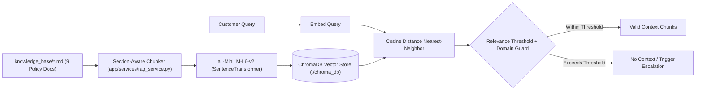
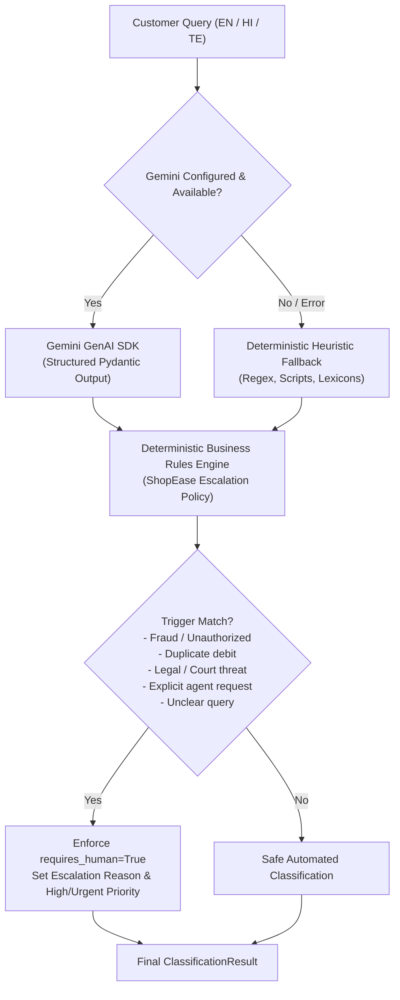

# ShopEase: AI-Powered Customer Support & Ticket Resolution System

ShopEase is an intelligent, multi-turn customer support helpdesk and ticket resolution platform designed for e-commerce. It classifies incoming customer inquiries, checks knowledge base policies, enforces strict anti-hallucination guardrails, and escalates critical payment disputes or low-confidence queries to human specialists.

---

## 🛠️ Technology Stack

- **Backend Framework**: FastAPI (Python 3.10+)
- **Relational Database**: SQLite with SQLAlchemy ORM
- **Data Validation & Schemas**: Pydantic v2 & `pydantic-settings`
- **Vector Database**: ChromaDB (in-process persistent store at `./chroma_db`)
- **Embedding Model**: `sentence-transformers` (`all-MiniLM-L6-v2`, 384 dimensions, 100% local, zero external API latency or costs)
- **UI Frontend**: Streamlit
- **Testing**: pytest, pytest-asyncio, HTTPX
- **LLM**: Google Gemini (orchestration & response generation phase)

---


## Reliability and safety design

The application is intentionally designed so the core support experience remains usable even when the optional Gemini API is unavailable or rate-limited.

- **Retrieval is independent of the LLM.** ChromaDB + `all-MiniLM-L6-v2` perform local semantic retrieval.
- **Hybrid reranking** combines semantic similarity, lexical overlap, and deterministic support-intent/topic affinity.
- **Semantic-first hybrid reranking** uses ChromaDB candidates plus lexical overlap, document category, and issue-analysis intent/category signals. It does not contain a phrase-to-answer or phrase-to-section FAQ router.
- **Answerability gates** reject unsupported numeric amounts, percentages, maximum/minimum claims, prices, surcharges, and cutoffs when the KB does not contain the requested fact.
- **Order IDs are treated as identifiers, not policy claims**, so a query such as `charged twice for order 12345` can still retrieve the duplicate-charge policy.
- **Grounding validation** rejects generated answers that introduce unsupported numeric facts or invalid KB references.
- **Safe extractive fallback** returns only evidence from the selected KB section when Gemini fails, times out, returns invalid output, or is not configured.
- **Human escalation is deterministic** for fraud, duplicate payments, legal threats, explicit human requests, severe frustration, lost/stalled delivery, and KB gaps.

This separation is important for an interview: Gemini improves natural-language presentation, but it is never trusted to invent ShopEase policy.

### Gemini configuration

The template uses the currently supported `gemini-3.8-flash` model ID. If a different supported model is available in your account, change only `GEMINI_MODEL`.

## 📁 Project Structure

```
shopease-ai-support/
├── app/
│   ├── __init__.py
│   ├── main.py                     # FastAPI app with lifespans, CORS, and routers
│   ├── config.py                   # Pydantic Settings reading .env (thresholds, paths)
│   ├── database.py                 # SQLite connection & session management
│   ├── models/                     # SQLAlchemy ORM models
│   │   ├── __init__.py
│   │   ├── ticket.py               # Ticket entity, status, priority, category enums
│   │   └── message.py              # Message entity and sender types
│   ├── schemas/                    # Pydantic validation schemas
│   │   ├── __init__.py
│   │   ├── ticket.py               # TicketCreate, TicketUpdate, TicketResponse
│   │   ├── message.py              # MessageBase, MessageResponse
│   │   ├── chat.py                 # ChatRequest, ChatResponse, ClassificationResult
│   │   └── kb.py                   # KBSearchRequest, KBSearchResponse, KBStatusResponse
│   ├── services/                   # Business logic and AI services
│   │   ├── __init__.py
│   │   └── rag_service.py          # Markdown chunker, embedding generation, ChromaDB RAG
│   └── api/                        # REST API Routers
│       ├── __init__.py
│       ├── tickets.py              # CRUD endpoints for support tickets
│       └── kb.py                   # Knowledge base indexing and semantic search
├── frontend/
│   └── app.py                      # Streamlit UI (Chat, Agent Dashboard, RAG Search & KB Docs)
├── knowledge_base/                 # ShopEase official policy documents (Markdown)
│   ├── returns_and_refunds.md
│   ├── payment_and_billing.md
│   ├── shipping_and_delivery.md
│   ├── cancellations_and_modifications.md
│   ├── account_and_security.md
│   ├── damaged_and_wrong_products.md
│   ├── promotions_and_coupons.md
│   ├── general_faq.md
│   └── human_escalation_policy.md
├── tests/
│   ├── __init__.py
│   ├── conftest.py                 # In-memory SQLite fixtures & TestClient
│   ├── test_database.py            # Model relationships & cascade tests
│   ├── test_tickets_api.py         # Endpoints integration tests
│   └── test_rag.py                 # RAG indexing, retrieval, and threshold tests
├── .env.example                    # Environment variable template
├── .gitignore
├── requirements.txt
└── README.md
```

---

## 🧠 RAG & Knowledge-Base Architecture

The Retrieval-Augmented Generation (RAG) subsystem prevents AI hallucinations by ensuring that answers are grounded strictly in ShopEase company policy documents.



### Key RAG Features:
1. **Section-Aware Chunking**: Markdown files are split along logical section boundaries (`## Section Title`), preserving context headers, policy rules, and bullet points intact.
2. **Local High-Performance Embeddings**: Uses `all-MiniLM-L6-v2` locally through `sentence-transformers`. No API keys or rate limits apply to embedding generation.
3. **Hybrid Retrieval & Reranking**: ChromaDB first retrieves a larger semantic candidate set. Candidates are then reranked using semantic similarity plus lexical/topic overlap and common support-language expansions. This prevents questions such as "How long does standard delivery take?" from being matched to an unrelated policy section.
4. **Strict Relevance Gate**: Obvious non-ShopEase questions and weak candidates are rejected before Gemini sees them. A missing/weak context is escalated instead of being passed to the generator as if it were authoritative.
5. **Grounded Generation**: Gemini receives the top-K retrieved policy chunks as authoritative context and is instructed to rewrite them into a concise, natural response without inventing facts. The application never asks Gemini to answer when retrieval returns no relevant context.
6. **Conversation-Aware Retrieval**: Short follow-up questions can be combined with the previous customer turn for retrieval while the original conversation is preserved for response generation.
7. **Metadata Preservation**: Every chunk retains `source`, `category`, `topic`, `doc_title`, and `chunk_id`.

---


## Conversation and ticket persistence

Every new customer conversation creates a unique ticket in SQLite. Every user turn and every AI response is stored as a `Message` linked to that ticket, including the retrieved KB traceability references used for the answer.

Continuing a ticket sends the recent stored messages back through the classification/RAG/response pipeline, so follow-up questions can use conversation context. The Agent Dashboard lists saved tickets, and the Customer Support sidebar can resume a saved ticket after a Streamlit refresh.

This means:
- **New conversation** → new ticket.
- **Every message in that conversation** → persistent database record.
- **Refresh/reopen** → saved ticket can be loaded from the database.
- **GET `/api/v1/tickets/{ticket_id}`** → ticket metadata plus complete message history.
- **GET `/api/v1/tickets`** → ticket list for the agent dashboard.

## Retrieval quality and grounding contract

The application deliberately separates **retrieval** from **generation**:

1. ChromaDB retrieves a wide candidate set from all supplied Markdown policy documents.
2. A deterministic intent/topic reranker selects the section that best matches the customer's actual request (for example, Express delivery is ranked above generic delayed-delivery policy).
3. An answerability gate rejects concrete claims that are not supported by the selected evidence.
4. Only accepted evidence is sent to Gemini.
5. Gemini is instructed to paraphrase the evidence, not add policy facts.
6. A post-generation validator rejects unsupported numeric claims or invalid KB references.
7. If retrieval or generation cannot safely support the answer, the system gives an explicit insufficient-information response and flags human review.

The system therefore does **not** use Gemini's general knowledge as a replacement for the supplied ShopEase policy library.

### Recommended RAG verification matrix

| Question type | Expected evidence |
|---|---|
| Standard delivery | Shipping Tiers and Service Timelines |
| Express delivery | Shipping Tiers and Service Timelines |
| Same-day delivery | Shipping Tiers and Service Timelines |
| Return policy/window | Return Window and Eligibility Overview |
| Card/UPI refund timing | Inspection and Refund Timelines |
| Return shipping fee | Return Shipping Charges |
| Duplicate payment | Duplicate Charges and Double Deductions |
| Unauthorized transaction | Unauthorized Transactions and Card Fraud |
| Delayed package | Delayed Deliveries and Escalation Protocol |
| Delivered but not received | Package Marked Delivered but Not Received |
| Coupon application | Applying Discount Promo Codes |
| Cashback | Bank and Payment Partner Offers |
| Unsupported maximum/percentage | No fabricated answer; human review |

## 🚀 Quickstart Guide

### 1. Environment Setup

```bash
# Windows (PowerShell)
python -m venv .venv
.\.venv\Scripts\activate

# macOS / Linux
python3 -m venv .venv
source .venv/bin/activate
```

Install dependencies:

```bash
pip install -r requirements.txt
```

### 2. Configuration

Copy the sample environment file:

```bash
# Windows (PowerShell)
Copy-Item .env.example .env

# Linux / macOS
cp .env.example .env
```

### 3. Run FastAPI Backend

```bash
uvicorn app.main:app --reload --port 8000
```

- API Base URL: `http://127.0.0.1:8000`
- Interactive OpenAPI Docs: `http://127.0.0.1:8000/docs`
- Health Endpoint: `http://127.0.0.1:8000/health`
- KB Status Endpoint: `http://127.0.0.1:8000/api/v1/kb/status`

> **Note**: On server startup, the knowledge base is rebuilt from the current Markdown files. This intentionally removes stale vector chunks from previous project versions so the demo always searches the supplied KB.

### 4. Run Streamlit UI

In a separate terminal:

```bash
streamlit run frontend/app.py
```

- Streamlit Web App: `http://localhost:8501`
- Includes live interactive semantic retrieval testing under the **"📚 Knowledge Center"** tab with semantic retrieval testing, policy browsing, and re-index controls.

---

## 🔍 How to Use the Knowledge Base & RAG Layer

### Check Indexing Health
```bash
curl -X GET http://127.0.0.1:8000/api/v1/kb/status
```

Response:
```json
{
  "is_indexed": true,
  "total_chunks": 44,
  "collection_name": "shopease_knowledge_base",
  "persist_directory": "C:\\Users\\...\\shopease-ai-support\\chroma_db",
  "embedding_model": "all-MiniLM-L6-v2",
  "threshold": 0.6
}
```

### Reindex the Knowledge Base
To force re-read of all `.md` files and re-embed them:
```bash
curl -X POST http://127.0.0.1:8000/api/v1/kb/reindex
```

Response:
```json
{
  "status": "success",
  "total_documents": 9,
  "total_chunks": 44,
  "message": "Successfully indexed 44 chunks across 9 policy documents."
}
```

### Search / Retrieve Relevant Policy Chunks
```bash
curl -X POST http://127.0.0.1:8000/api/v1/kb/search \
  -H "Content-Type: application/json" \
  -d '{
    "query": "My payment was charged twice for order #9921",
    "top_k": 3
  }'
```

Response:
```json
{
  "query": "My payment was charged twice for order #9921",
  "results_count": 3,
  "has_sufficient_context": true,
  "results": [
    {
      "content": "Policy Document: ShopEase Payment, Billing, and Dispute Resolution Policy\nSection: 3. Duplicate Charges and Double Deductions (High Priority)\n\n## 3. Duplicate Charges and Double Deductions...",
      "source": "payment_and_billing.md",
      "category": "payment_and_billing",
      "topic": "3. Duplicate Charges and Double Deductions (High Priority)",
      "chunk_id": "payment_and_billing_sec_3",
      "distance": 0.5421,
      "similarity_score": 0.7289,
      "metadata": {
        "source": "payment_and_billing.md",
        "category": "payment_and_billing",
        "topic": "3. Duplicate Charges and Double Deductions (High Priority)",
        "doc_title": "ShopEase Payment, Billing, and Dispute Resolution Policy",
        "chunk_id": "payment_and_billing_sec_3"
      }
    }
  ]
}
```

### AI Query Classification & Escalation Analysis
```bash
curl -X POST http://127.0.0.1:8000/api/v1/classify \
  -H "Content-Type: application/json" \
  -d '{
    "query": "My card was charged twice for the same order and I want my money back."
  }'
```

Response:
```json
{
  "category": "PAYMENT",
  "priority": "HIGH",
  "intent": "duplicate_charge",
  "sentiment": "FRUSTRATED",
  "language": "English",
  "requires_human": true,
  "escalation_reason": "Duplicate payment requires finance team review and reversal."
}
```

---

## 🤖 Gemini LLM & Classification Flow



### Deterministic Business Rules (Override Layer)
Regardless of whether classification is performed by Gemini or the fallback engine, deterministic business rules enforce human escalation for:
1. **Unauthorized Transactions / Suspected Card Fraud**: Set to `PAYMENT`, `URGENT` priority, `requires_human=true`.
2. **Duplicate Payment / Double Deductions**: Set to `PAYMENT`, `HIGH` priority, `requires_human=true`.
3. **Explicit Agent Requests**: ("talk to human", "agent please", "इंसान से बात", "మనిషితో మాట్లాడాలి") triggers `requires_human=true`.
4. **Legal / Regulatory Threats**: ("court", "lawyer", "police", "sue") forces `URGENT` priority, `requires_human=true`.
5. **Gibberish / Incomprehensible Queries**: Marked `requires_human=true` with reason `Query unclear`.

---

## 🧪 Running Tests

Execute the complete test suite with `pytest`:

```bash
pytest -v
```

All 28 tests cover:
- Relational SQLite database models & cascade deletions
- Support Ticket CRUD & filtering APIs
- Knowledge base parsing & ChromaDB document indexing
- Semantic retrieval accuracy across payments, refunds, and shipping
- Out-of-domain query rejection (anti-hallucination gating)
- AI Query classification across English, Hindi, and Telugu
- Deterministic escalation overriding non-escalating LLM outputs
- Gemini API error handling and graceful fallback without crashes


## Grounding and traceability contract

The application deliberately separates **retrieval**, **generation**, and **verification**:

1. ChromaDB searches the complete indexed ShopEase policy library and retrieves a candidate set.
2. Hybrid reranking combines semantic similarity with lexical/topic overlap.
3. An answerability gate rejects weak or overly generic matches. Requested numeric facts and qualifiers such as maximum/minimum/percentage must be supported by the retrieved evidence.
4. Only accepted evidence is sent to Gemini.
5. Gemini is instructed to rewrite evidence into a concise, structured customer answer; it is not allowed to supply missing policy facts.
6. A post-generation validator checks generated numeric claims and KB references against the retrieved evidence. If validation fails, the application uses a safe evidence-only fallback.
7. Every grounded answer exposes a stable internal **KB reference** such as `KB-SHIP-01`, plus the exact source file and Markdown section. These are traceability identifiers generated from the supplied KB; they are not claimed to be official external policy numbers.
8. If the KB cannot answer the customer's specific question, Gemini is not used to invent an answer. The ticket is marked for human review.

### Example

For `How much does express shipping cost?`, the answer can be formatted as:

> **Express Shipping**
> - Delivery: **1–2 business days**
> - Surcharge: **₹99**
> - Availability: **select metropolitan cities**
>
> **KB reference:** `KB-SHIP-01` — Shipping Tiers and Service Timelines

For `What is the maximum refund amount?`, if no KB evidence specifies a maximum, the system returns an insufficient-information response and escalates instead of inventing an amount.

## Interview-ready grounded chat flow

`Customer query → contextual issue analysis → Chroma semantic retrieval + lexical/topic reranking → relevance/answerability gate → Gemini receives query + exact retrieved KB evidence + conversation history → grounded structured answer → grounding validator → concise local KB fallback if Gemini is unavailable/slow/unsafe → SQLite persistence.`

The UI exposes both the **Policy reference** and the **exact retrieved KB evidence**, so the interviewer can see where the answer came from. Gemini is transport-time limited; a slow model cannot block the support ticket indefinitely. The local fallback never invents a policy and never dumps an entire retrieved document.


## LLM-grounded RAG generation

The production chat path is explicitly: customer query -> issue analysis -> ChromaDB semantic retrieval -> relevance/answerability checks -> retrieved policy chunks -> Gemini structured generation -> grounding validation -> SQLite persistence. The Gemini prompt receives the actual retrieved Markdown policy chunks (source, section, relevance and chunk content), not a hard-coded answer. The API response exposes `llm_used`, `generation_method`, `generation_model`, `grounding_verified`, and `retrieval_query` so the RAG-to-LLM handoff can be demonstrated during an interview.

If Gemini is unavailable, the system does not pretend Gemini answered: it uses a labeled `local_kb_fallback` or `grounded_refusal` mode and records that mode in the ticket message trace.


## Interview proof: retrieval -> LLM -> grounded answer

For a normal supported query, the application records and exposes:

1. `retrieval_query` — the query actually sent to ChromaDB.
2. `retrieved_evidence` — exact source file, section, relevance score, and retrieved policy text.
3. `llm_used=true` and `generation_method=gemini` when Gemini generated the response.
4. `generation_model` — the configured Gemini model.
5. `grounding_verified=true` only after the generated response passes the grounding validator.

This makes the interview demonstration explicit: **query -> Chroma retrieval -> retrieved policy evidence -> Gemini -> validated answer**.
